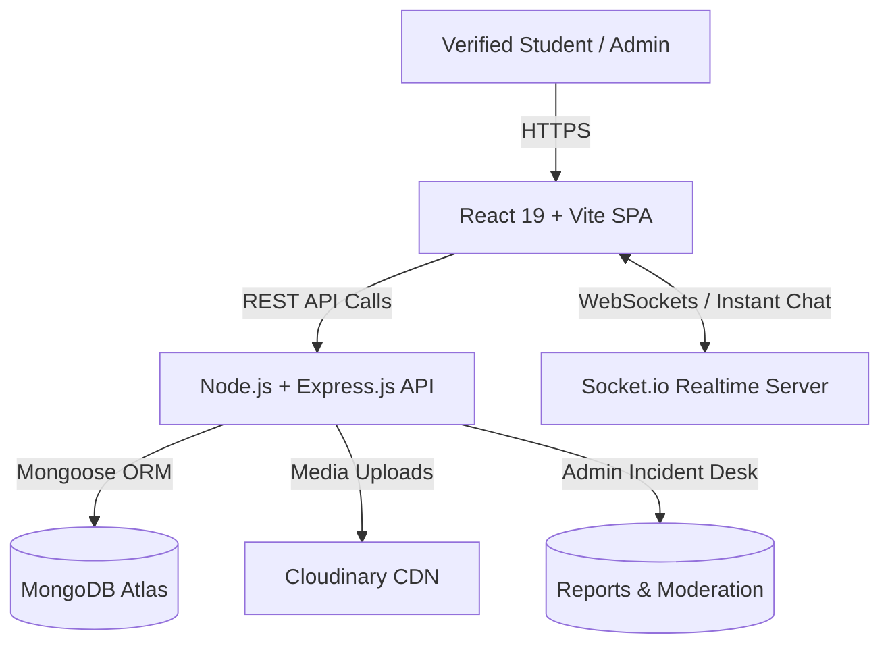

<div align="center">
  
</div>

<h1 align="center">CampusLoop 🎓🚀</h1>

<p align="center">
  <a href="https://reactjs.org/"></a>
  <a href="https://vitejs.dev/"></a>
  <a href="https://nodejs.org/"></a>
  <a href="https://expressjs.com/"></a>
  <a href="https://www.mongodb.com/"></a>
  <a href="https://tailwindcss.com/"></a>
  <a href="https://socket.io/"></a>
</p>

<p align="center">
  <em>An exclusive, safe, peer-to-peer campus marketplace designed specifically for verified university students. Buy, sell, trade, and chat with zero platform fees.</em>
</p>

<p align="center">
  🌐 <strong>Live Production URL:</strong> <a href="https://campusloop-nine.vercel.app/">https://campusloop-nine.vercel.app/</a>
</p>

---

## 📑 Table of Contents
- [✨ Key Features](#-key-features)
- [🛡️ Admin Dashboard & Moderation](#️-admin-dashboard--moderation)
- [🏗️ System Architecture](#️-system-architecture)
- [💻 Tech Stack](#-tech-stack)
- [🚀 Quick Start & Installation](#-quick-start--installation)
- [🔐 Admin Setup & Credentials](#-admin-setup--credentials)
- [📡 API Endpoints](#-api-endpoints)
- [🔍 SEO & Legal Compliance](#-seo--legal-compliance)
- [🤝 Community & Safety Guidelines](#-community--safety-guidelines)

---

## ✨ Key Features

- **🎓 Verified Student Email Authentication:** Restricts registration to verified institutional domains (`.edu`, `.ac.in`), eliminating non-student bots and commercial spam.
- **⚡ Dynamic Marketplace & Filters:** Search by title, filter by category (*Textbooks, Electronics, Dorm Gear, Furniture, Clothing*), condition, price range, and sort by recent or price.
- **💬 Real-Time In-App Chat:** Instant peer-to-peer messaging powered by Socket.io so buyers and sellers coordinate meetups without giving out private phone numbers.
- **🚫 Block & Report System:** Students can block abusive users (instantly hiding their listings and conversations) and report suspicious listings or malicious accounts.
- **⭐ Authentic Transaction Reviews:** Buyers submit star ratings and written reviews after completed transactions, establishing a genuine campus trust score.
- **🖼️ Cloudinary Image Hosting:** Multi-image uploads with automatic optimization and responsive delivery.
- **🌗 Theme-Adaptive Modern UI:** Zero-FOUC Dark/Light mode, custom glassmorphism design tokens, and smooth Framer Motion micro-animations.

---

## 🛡️ Admin Dashboard & Moderation

CampusLoop includes a dedicated, role-protected **Admin Control Panel** (`/admin`):

- **User Oversight:** View all registered students, their verification status, and block/restriction status.
- **User Actions:** Restrict, block, or delete malicious or violating accounts.
- **Listing Moderation:** Hide or delete prohibited listings (*academic dishonesty material, weapons, unauthorized items*).
- **Incident Reports Desk:** Review real-time user-generated reports with full context (reporter, target user, target listing, reason) and take immediate action.

---

## 🔐 Admin Setup & Credentials

An administrator account can be created in the database using the built-in seed script:

### Default Admin Credentials
| Field | Value |
| :--- | :--- |
| **Email** | `admin@campusloop.org` |
| **Password** | `admin@campusloop` |
| **Role** | `admin` |
| **Admin Route** | `/admin` |

### To Seed the Admin Account:
```bash
cd backend
node seedAdmin.js
```
*(If an admin with `admin@campusloop.org` already exists, the script safely exits without overwriting).*

---

## 🏗️ System Architecture



---

## 💻 Tech Stack

### Frontend
- **Framework:** React 19 + Vite
- **Routing:** React Router DOM v7
- **Styling:** Tailwind CSS + Vanilla CSS Tokens
- **Animations:** Framer Motion
- **Icons:** Material Symbols Outlined & Lucide React
- **Notifications:** React Hot Toast
- **Real-Time Client:** Socket.io-client
- **HTTP Client:** Axios

### Backend
- **Runtime:** Node.js
- **Server:** Express.js
- **Database:** MongoDB (Mongoose ORM)
- **Authentication:** JWT (JSON Web Tokens) + Bcryptjs Password Hashing
- **Real-Time:** Socket.io
- **Media Uploads:** Multer + Cloudinary Storage
- **Security:** CORS, Helmet-compatible headers, custom sanitization

---

## 🚀 Quick Start & Installation

### Prerequisites
- [Node.js](https://nodejs.org/) (v18 or higher recommended)
- [MongoDB](https://www.mongodb.com/) (Local instance or MongoDB Atlas URI)
- [Cloudinary](https://cloudinary.com/) account for image uploads

### 1. Clone the Repository
```bash
git clone https://github.com/raghavendra-kumar04/CampusLoop.git
cd CampusLoop
```

### 2. Configure Backend
```bash
cd backend
npm install
```

Create a `.env` file in the `backend/` directory:
```env
PORT=5000
MONGODB_URI=your_mongodb_connection_string
JWT_SECRET=your_jwt_secret_key
CLOUDINARY_CLOUD_NAME=your_cloud_name
CLOUDINARY_API_KEY=your_api_key
CLOUDINARY_API_SECRET=your_api_secret
GEMINI_API_KEY=your_gemini_api_key_optional
```

Seed the administrator account:
```bash
node seedAdmin.js
```

Start backend development server:
```bash
npm run dev
```

### 3. Configure Frontend
Open a new terminal window:
```bash
cd frontend
npm install
npm run dev
```

The application will start locally at `http://localhost:5173`.

---

## 📡 API Endpoints

### Authentication & Users
- `POST /api/auth/register` — Register a new student (`.edu` / `.ac.in`)
- `POST /api/auth/login` — Sign in (students & admins)
- `GET /api/auth/me` — Get current authenticated user profile
- `POST /api/users/:id/block` — Block or unblock a user
- `GET /api/users/profile/:id` — View a student's public campus profile

### Marketplace Listings
- `GET /api/listings` — Fetch active listings with query filters
- `GET /api/listings/:id` — Fetch listing details
- `POST /api/listings` — Create a new listing (with image upload)
- `PUT /api/listings/:id` — Update listing details or status (`Available` / `Sold`)
- `DELETE /api/listings/:id` — Delete a listing

### Incident Reports & Moderation (Admin)
- `POST /api/reports` — Submit a user or listing report
- `GET /api/admin/reports` — Fetch all pending reports (Admin only)
- `PUT /api/admin/reports/:id` — Resolve or dismiss report (Admin only)
- `GET /api/admin/users` — List and manage users (Admin only)
- `PUT /api/admin/users/:id/restrict` — Toggle user restriction (Admin only)
- `DELETE /api/admin/users/:id` — Remove user account (Admin only)
- `PUT /api/admin/listings/:id/hide` — Toggle listing visibility (Admin only)
- `DELETE /api/admin/listings/:id` — Permanently delete listing (Admin only)

### Real-Time Chat & Reviews
- `GET /api/chats` — Get active conversations
- `POST /api/chats/message` — Send a direct message
- `POST /api/reviews` — Submit post-transaction peer rating

---

## 🔍 SEO & Legal Compliance

CampusLoop follows modern technical SEO best practices to ensure discoverability and safety:

- **Robots & Sitemap:** Search engine compliant `robots.txt` allowing public indexable pages and disallowing private user states. Complete `sitemap.xml` with canonical production URLs.
- **Dynamic Head Metadata:** Reactive `SEO.jsx` component setting page titles, meta descriptions, canonical URLs, and Open Graph / Twitter Cards on every route.
- **Structured Data (JSON-LD):** Implements `WebSite`, `Organization`, `BreadcrumbList`, `FAQPage`, and `Product` Schema.org specifications.
- **Dedicated Public Pages:**
  - `/how-it-works` — Step-by-step student trading guide and safety FAQ.
  - `/privacy` — Comprehensive Student Data Privacy Policy (zero third-party data selling).
  - `/terms` — Marketplace Terms, Academic Integrity code, and safe campus meetup zones.
  - `*` (404) — Friendly `NotFound` page with `noindex` directive to eliminate soft 404 penalties.

---

## 🤝 Community & Safety Guidelines

1. **Trade in Public Safe Zones:** Always meet in high-traffic campus locations (library lobbies, student union, campus safety centers).
2. **Inspect Before Paying:** Check items in person prior to cash or instant digital payment.
3. **Academic Integrity:** Strictly prohibited: test banks, assignment solutions, or graded coursework materials.
4. **Zero Tolerance:** Immediate ban for counterfeit goods, harassment, or non-student fraud.

---

<div align="center">
  <p>Built with ❤️ for university communities everywhere.</p>
  <p>© 2026 CampusLoop. All rights reserved.</p>
</div>
